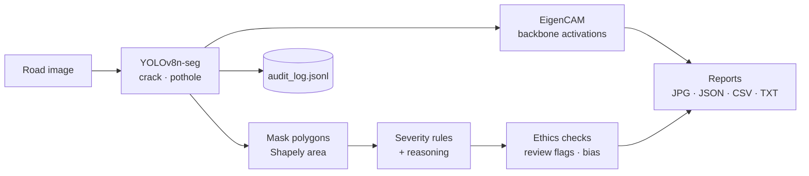

<h1 align="center">🛣️ AI-Powered Structural Crack Analysis & Risk Reporting</h1>

<p align="center">
  <b>YOLOv8 instance segmentation</b> for <b>cracks and potholes</b>, with severity scoring, area measurement,<br/>
  <b>EigenCAM explainability</b>, and an <b>ethical-AI audit trail</b>, served through Streamlit.
</p>

<p align="center">
  
  
  
  
  
</p>

---

## 📌 Overview

Manual road inspection is slow, subjective and hard to audit. This project takes a road photo and returns:

1. **Pixel-level masks** of every crack and pothole (YOLOv8n-seg),
2. **Area** from the mask polygon in px², or in cm² when a scale is given,
3. **Severity**: 🟢 Low / 🟠 Moderate / 🔴 High, each with a written reason,
4. **EigenCAM heatmap** showing where the model looked,
5. **Ethics report**: low-confidence flags, bias warnings and dataset provenance,
6. **Downloadable reports** (annotated image, heatmap, JSON, CSV, ethics text) plus a JSONL **audit log** of every inference.

## 🏗️ Pipeline



| Severity rule | Crack | Pothole |
|---|---|---|
| 🟢 Low | < 300 px² | < 800 px² |
| 🟠 Moderate | 300 – 1,500 px² | 800 – 3,000 px² |
| 🔴 High | ≥ 1,500 px² | ≥ 3,000 px² |

Any detection with confidence **< 0.40** is flagged for **mandatory human review**.

### App flow (what happens when you click *Analyse Image*)

| Step | Module | Output |
|---|---|---|
| 1. Detect | `detector.py` → `RoadDefectDetector.detect()` | One `Detection` per defect: class, confidence, box, mask polygon, area, severity + reason, review flag. A line is appended to `audit_log.jsonl`. |
| 2. Annotate | `detector.py` → `annotate_image()` | Image with masks and boxes coloured by severity (**tab 1**) |
| 3. Explain *(optional)* | `explainability.py` → `generate_explanation()` | EigenCAM heatmap + per-detection "visual support" text (**tab 2**) |
| 4. Report | `app.py` | Per-detection metrics and reasoning (**tab 3**) |
| 5. Ethics | `ethics.py` → `generate_ethics_report()` | Disclaimer, review count, class / severity mix, bias warnings, provenance (**tab 4**) |
| 6. Save *(optional)* | `report.py` → `generate_report()` | `reports/<image>_<time>_{annotated,heatmap}.jpg`, `_report.json`, `_report.csv`, `_ethics.txt` |

### Data preparation flow

The prepared dataset is already in `unified_dataset/`, so you only need these steps to rebuild it. Run them from the repository root, in order:

| Step | Script | What it does |
|---|---|---|
| 1 | `potholes_conversion.py` | Pascal VOC XML in `potholes/` → YOLO box labels in `potholes_yolo/` |
| 2 | `merge_data.py` | Merges `crack-seg/` + `potholes_yolo/` → `unified_dataset/` (0 = crack, 1 = pothole), writes `data.yaml` |
| 3 | `fix.py` | Converts pothole box labels to 4-point polygons so every label is a segmentation polygon |
| 4 | `clean_labels.py` | Drops invalid lines, clips coordinates to [0, 1] |
| 5 | `verify.py` | Prints counts per split, adds empty labels for background images |
| 6 | `train.py` | Trains YOLOv8n-seg → `runs/segment/runs/road_defect_seg<N>/weights/best.pt` |

---

## 📸 Screenshots

**Pothole: detection and severity**

| Annotated result | EigenCAM heatmap |
|---|---|
|  |  |

| Detection report | Ethics & transparency |
|---|---|
|  |  |

**Crack: segmentation and explainability**

| Annotated result | EigenCAM heatmap |
|---|---|
|  |  |

Upload screen:


---

## 📊 Evaluation

### Dataset

| Split | Images | Classes |
|---|---|---|
| Train | 4,249 | crack + pothole |
| Validation | 333 | 249 crack instances, 299 pothole instances |
| Test | 112 | crack only |

Sources: Ultralytics *crack-seg* and the *Annotated Potholes* dataset, merged into YOLO-seg format with `merge_data.py`.

**Training:** YOLOv8n-seg, 50 epochs, image size 416, batch 16, early-stopping patience 15.

### Results on the validation set (re-measured from `best.pt`)

| Class | Box P | Box R | **Box mAP50** | Box mAP50-95 | Mask P | Mask R | **Mask mAP50** | Mask mAP50-95 |
|---|---|---|---|---|---|---|---|---|
| Crack | 0.794 | 0.755 | **0.812** | 0.630 | 0.731 | 0.695 | **0.699** | 0.249 |
| Pothole | 0.801 | 0.688 | **0.776** | 0.510 | 0.790 | 0.677 | **0.765** | 0.436 |
| **All** | **0.798** | **0.721** | **0.794** | **0.570** | **0.760** | **0.686** | **0.732** | **0.343** |

**Held-out test set (cracks only, 112 images):** box mAP50 **0.747**, mask mAP50 **0.642**, box precision 0.859.

**Speed:** about 50 ms per image on CPU (Intel Xeon, 416 px), so it is real-time capable on a GPU.

| Normalised confusion matrix | Mask precision–recall curve |
|---|---|
|  |  |

- **96%** of cracks and **95%** of potholes are classified correctly, and the model **never confuses a crack with a pothole**.
- Most errors are **false positives on background** (right-hand column), such as road texture or shadows. That's why the app adds the confidence-review flag and human verification.
- Mask mAP50-95 for cracks (0.249) is lower than for boxes. Thin cracks are hard to outline exactly, and a few pixels of misalignment strongly reduce IoU.

**Training curves**


| Ground truth (validation batch) | Predictions |
|---|---|
|  |  |

### Explainability check

A *pointing-game* test asks whether the EigenCAM heatmap is hotter inside the detected box than across the image as a whole. It was run on 84 validation images that had detections.

| EigenCAM version | Box hotter than image average |
|---|---|
| Original | 19.4% |
| **With sign correction (this update)** | **66.2%** |

All numbers are in [`docs/evaluation/metrics.json`](docs/evaluation/metrics.json).

---

## ✅ Test case scenarios

Run with `pytest -v`. The tests use the trained weights and real validation images.

| # | Scenario | Expected result | Status |
|---|---|---|---|
| TC01 | Severity thresholds at boundaries (7 cases, crack and pothole) | Correct Low / Moderate / High | ✅ Pass |
| TC02 | High-severity defect with low confidence | Stays HIGH and asks for human verification | ✅ Pass |
| TC03 | Confidence explanation at 0.9 / 0.6 / 0.3 | high / moderate / low wording | ✅ Pass |
| TC04 | Crack image | Crack detected (conf > 0.5) with a valid mask polygon | ✅ Pass |
| TC05 | Pothole image | Pothole detected (conf > 0.5) | ✅ Pass |
| TC06 | Plain grey image (no defect) | No detections, so no false alarm | ✅ Pass |
| TC07 | Pixels-per-cm scale set | `area_cm2 = area_px / scale²` | ✅ Pass |
| TC08 | Confidence threshold 0.10 vs 0.80 | Stricter threshold never adds detections | ✅ Pass |
| TC09 | Audit trail | Every inference is written to the JSONL log | ✅ Pass |
| TC10 | Annotated output | Same size as input, overlays drawn | ✅ Pass |
| TC11 | EigenCAM | Heatmap the same size as the image, plus a text summary | ✅ Pass |
| TC12 | Low-confidence detection | Ethics report says "MANDATORY HUMAN REVIEW" | ✅ Pass |
| TC13 | Report export | Annotated JPG, heatmap, JSON, CSV and ethics TXT all written | ✅ Pass |

Full output: [`docs/test_results.txt`](docs/test_results.txt).

## 🚀 Getting started

```bash
git clone https://github.com/akshaya3107/Structural-Crack-Analysis-And-Risk-Reporting.git
cd Structural-Crack-Analysis-And-Risk-Reporting
python -m venv venv                # create a virtual environment
venv/Scripts/activate              # Windows
# source venv/bin/activate         # Linux / macOS
pip install -r requirements.txt

streamlit run app.py               # web app
pytest -v                          # run the tests
python train.py                    # retrain (GPU recommended)
yolo segment val model=runs/segment/runs/road_defect_seg6/weights/best.pt data=unified_dataset/data.yaml imgsz=416
```

### Configuration

Set these as environment variables or in a `.env` file in the repository root. All are optional.

| Variable | Default | Meaning |
|---|---|---|
| `MODEL_PATH` | `./runs/segment/runs/road_defect_seg6/weights/best.pt` | Trained weights used by the app |
| `CONFIDENCE_THRESHOLD` | `0.25` | Minimum confidence for a detection (the app's sidebar slider overrides it) |
| `REVIEW_THRESHOLD` | `0.40` | Detections below this are flagged for human review |
| `AUDIT_LOG_PATH` | `audit_log.jsonl` | Where every inference is logged |

Generated at runtime and ignored by git: `reports/`, `explanations/`, `audit_log.jsonl`.

## 🗂️ Project structure

```
├── app.py               # Streamlit UI (4 tabs: result · heatmap · report · ethics)
├── detector.py          # YOLOv8 inference, area, severity, annotation, audit log
├── explainability.py    # EigenCAM heatmap + XAI text
├── ethics.py            # Review flags, bias warnings, provenance
├── report.py            # JPG / JSON / CSV / TXT report export
├── train.py             # Training script
├── potholes_conversion.py, merge_data.py, fix.py, clean_labels.py, verify.py   # Data preparation (steps 1–5)
├── crack-seg/           # Source: Ultralytics crack-seg (YOLO-seg format)
├── potholes/            # Source: Annotated Potholes (Pascal VOC XML)
├── potholes_yolo/       # Step 1 output
├── unified_dataset/     # Merged YOLO-seg dataset (train / val / test)
├── runs/segment/runs/road_defect_seg6/   # Final training run + weights (earlier runs kept for reference)
├── yolov8n-seg.pt       # Pretrained base weights used by train.py
├── tests/test_pipeline.py
└── docs/                # Screenshots, evaluation plots, metrics
```

## ⚖️ Responsible AI

- Outputs are **advisory**. Repair decisions need a qualified engineer.
- Low-confidence detections are flagged, and every run is logged for audit.
- **Known limitations:** training data is mostly daylight images of paved roads. Expect weaker results at night, on wet surfaces or on unpaved roads. Severity thresholds are in pixels, so they depend on camera distance unless a cm scale is set.

## 🛠️ Tech stack

`Python` · `Ultralytics YOLOv8` · `PyTorch` · `OpenCV` · `Shapely` · `NumPy` · `Streamlit` · `EigenCAM (XAI)` · `pytest`

